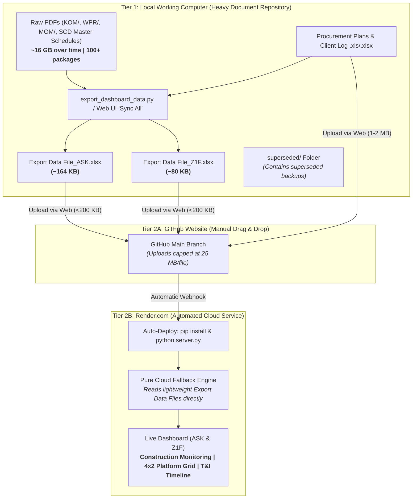

# Manual Upload & Deployment Wrap-Up Guide (GitHub & Render.com)

**Project:** Weekly Project Management & Vendor Package Monitoring Dashboard (ASK & Z1F)  
**Document Code:** WRAPUP-VTRK-2026-002  
**Release Date:** November 14, 2026 (Updated from November 13, 2026 baseline)  
**Target Environment:** Local Working Computer / Render.com Cloud $\rightarrow$ GitHub (`🚀 Push to GitHub` or Web UI) $\rightarrow$ Render.com Cloud  

---

## 1. Pre-Flight Architecture Summary: Two-Tier Decoupled Flow



---

## 2. File Upload Matrix (What to Upload vs What to Keep Local)

### A. Core Application Files to Upload to GitHub (November 14, 2026 Release)

Drag and drop these files into the GitHub Web UI once (after setting `GITHUB_TOKEN` & `GITHUB_REPO` in Render, weekly data updates can use **`🚀 Push to GitHub`** directly from the dashboard):

| File / Directory | Location in Repo | Size Range | Action | Description of Nov 14, 2026 Updates |
| :--- | :--- | :---: | :---: | :--- |
| [`Export Data File_ASK.xlsx`](file:///c:/Users/pipes/OneDrive/Documents/Google_AntiGravity/Project/Vendor%20Tracking/Export%20Data%20File_ASK.xlsx) | Workspace Root | **~183 KB** | **UPLOAD** | Refreshed with ASK WPR progress, S-curves, `WPR_Milestones`/`WPR_Progress`, `VDRL_Summary`, `Master_Construction`, MOM actions, and full-scope 7d/14d LookAhead (`468`/`619`). |
| [`Export Data File_Z1F.xlsx`](file:///c:/Users/pipes/OneDrive/Documents/Google_AntiGravity/Project/Vendor%20Tracking/Export%20Data%20File_Z1F.xlsx) | Workspace Root | **~114 KB** | **UPLOAD** | Refreshed with Z1F `.docx` WPR (`CCV` `WPR-002`, S-curve, `WPR_Milestones`/`WPR_Progress`), MOM actions, `Master_Construction`, and full-scope 7d/14d LookAhead (`330`/`494`). |
| [`server.py`](file:///c:/Users/pipes/OneDrive/Documents/Google_AntiGravity/Project/Vendor%20Tracking/server.py) | Workspace Root | ~20 KB | **UPLOAD** | Added `.docx` WPR auto-sync in `/api/upload`, `GET /api/github-status`, and `POST /api/push-github` (atomic GitHub commit). |
| [`index.html`](file:///c:/Users/pipes/OneDrive/Documents/Google_AntiGravity/Project/Vendor%20Tracking/index.html) | Workspace Root | ~74 KB | **UPLOAD** | Added **`🚀 Push to GitHub`** button, 4-step Quick Guide in the upload modal, and `app.js?v=20261114_2`. |
| [`styles.css`](file:///c:/Users/pipes/OneDrive/Documents/Google_AntiGravity/Project/Vendor%20Tracking/styles.css) | Workspace Root | ~51 KB | **UPLOAD** | Styles for `4×2` platform milestone grid, T&I timeline badges, Construction Gantt bars, and Critical Path indicators. |
| [`app.js`](file:///c:/Users/pipes/OneDrive/Documents/Google_AntiGravity/Project/Vendor%20Tracking/app.js) | Workspace Root | ~210 KB | **UPLOAD** | Added default-hidden toggle on `1. Area of Concern — Vendor Delay Impact to Construction` (`ASK` & `Z1F`) and `triggerPushGithub()`. |
| [`export_dashboard_data.py`](file:///c:/Users/pipes/OneDrive/Documents/Google_AntiGravity/Project/Vendor%20Tracking/export_dashboard_data.py) | Workspace Root | ~15 KB | **UPLOAD** | Added `.docx` WPR, `WPR_Milestones`, `WPR_Progress`, `VDRL_Summary`, and `Master_Construction` export sync. |
| [`vendor_dashboard/ingestors.py`](file:///c:/Users/pipes/OneDrive/Documents/Google_AntiGravity/Project/Vendor%20Tracking/vendor_dashboard/ingestors.py) | `vendor_dashboard/` | ~182 KB | **UPLOAD** | Added `WPR_Milestones`/`WPR_Progress`/`VDRL_Summary`/`Master_Construction` cloud readers, full-scope `LookAhead` reader, and `_psr_sort_key` `YYYYMMDD` sorting. |
| [`vendor_dashboard/reconciler.py`](file:///c:/Users/pipes/OneDrive/Documents/Google_AntiGravity/Project/Vendor%20Tracking/vendor_dashboard/reconciler.py) | `vendor_dashboard/` | ~140 KB | **UPLOAD** | Added full-scope `export_lookahead_7d`/`14d` cloud fallback parity for ASK and Z1F. |
| [`vendor_dashboard/extractors/excel_sync.py`](file:///c:/Users/pipes/OneDrive/Documents/Google_AntiGravity/Project/Vendor%20Tracking/vendor_dashboard/extractors/excel_sync.py) | `vendor_dashboard/extractors/` | ~23 KB | **UPLOAD** | Added `WPR_Milestones`, `WPR_Progress`, `VDRL_Summary`, and `Master_Construction` sheet writers. |
| [`.gitignore`](file:///c:/Users/pipes/OneDrive/Documents/Google_AntiGravity/Project/Vendor%20Tracking/.gitignore) | Workspace Root | <1 KB | **UPLOAD** | Excludes `superseded/`, `KOM/`, `WPR/`, `MOM/`, `VDRL/`, and `*.SCD-*.pdf`. |
| **Documentation (.md)** | Workspace Root | ~150 KB | **UPLOAD** | `Handoff_Report.md`, `Lesson_Learn.md`, `MANUAL_UPLOAD_WRAPUP.md`, `SPEC.md`, `README.md`. |

---

### B. What to Keep Strictly Local (DO NOT Upload to GitHub)

| Folder / File Pattern | Why Keep Local | Where It Goes |
| :--- | :--- | :--- |
| **`KOM/` folder** | 50–200 MB | Keep local. Vendor manufacturer details already extracted into Excel. |
| **`WPR/` folder** | 500 MB–5 GB | Keep local. All progress, S-curves, and Gantt charts already extracted into Excel. |
| **`MOM/` folder** | 100 MB–2 GB | Keep local. All contractual action items already extracted into Excel. |
| **`VDRL/` folder** | 50–200 MB | Keep local. Submittal baselines already parsed. |
| **`*.SCD-*.pdf` (Master Schedule)** | 12 MB+ each (216 pgs) | Keep local. 4,000+ activities and critical path float dates already extracted into LookAhead sheets and snapshots. |
| **`superseded/` folder** | Historical backups | Old UI backup `backup_original_ui_20261113` moved into `superseded/` and excluded from repository. |

---

## 3. The 5-Step Weekly Execution Checklist for GitHub & Render

### Step 1: Extract & Synchronize Locally
Before uploading, ensure `export_dashboard_data.py` was executed (already completed today!):
```powershell
python export_dashboard_data.py --project ALL
```
*Verification:* Both `Export Data File_ASK.xlsx` (~164 KB) and `Export Data File_Z1F.xlsx` (~80 KB) have today's timestamp (`2026-11-13`).

### Step 2: Open GitHub in Your Web Browser
1. Navigate to your repository on [github.com](https://github.com).
2. Click **Add file** $\rightarrow$ **Upload files** (located in the top-right toolbar).

### Step 3: Drag and Drop Updated Files onto GitHub Web
Drag the following files from your local File Explorer into the GitHub drop target:
1. `Export Data File_ASK.xlsx`
2. `Export Data File_Z1F.xlsx`
3. `index.html`
4. `styles.css`
5. `app.js`
6. `vendor_dashboard/ingestors.py` *(or navigate to `vendor_dashboard/` and upload)*
7. `vendor_dashboard/reconciler.py` *(or navigate to `vendor_dashboard/` and upload)*
8. `.gitignore`
9. `Handoff_Report.md`
10. `Lesson_Learn.md`
11. `MANUAL_UPLOAD_WRAPUP.md`
12. `SPEC.md`
13. `README.txt`
14. `README.md`

### Step 4: Commit Changes
1. Scroll down to **Commit changes**.
2. Type commit title: `Release 2026-11-13: Construction Monitoring, 4x2 Platform Grid, T&I Timeline & Deck Breakdown`.
3. Select **Commit directly to the main branch**.
4. Click **Commit changes**.

### Step 5: Verify on Render.com
1. Open [dashboard.render.com](https://dashboard.render.com).
2. Select your Web Service and observe the deploy logs:
   - Git commit webhook triggers automatically.
   - Build command installs dependencies from `requirements.txt`.
   - Start command runs `python server.py`.
   - Log shows `Dashboard HTTP server running at http://0.0.0.0:8080`.
3. Open your live Render URL.
4. Press **`Ctrl + F5`** (hard refresh to bypass browser caching) and verify:
   - Executive Summary displays **`Const. Monitoring`** button.
   - Clicking **`Const. Monitoring`** loads the Construction Monitoring view with 7d historical & 14d lookahead Gantt, vendor impact areas of concern, and Critical Path filter.
   - For **Z1F**: Executive Summary displays the responsive `4×2` platform grid (4 Jackets & Piles + 4 Topsides) sorted chronologically by Ready for Transportation date, with deck-level breakdown (`Lower Col.`, `Sump Deck`, `Lower Deck`, `Mezzanine Deck`, `Upper Deck`, `Vent Boom`) and the Attachment 3 T&I Timeline.
   - For **ASK**: Executive Summary displays `WPA-01` and `WPA-02` with deck-level erection milestones and critical material delivery dates.

---

## 4. Frequently Asked Questions (FAQ)

* **Q: Did moving old backups to `superseded/` break anything?**  
  **No.** `backup_original_ui_20261113` was moved into the local `superseded/` folder, keeping the root directory clean. `.gitignore` has been updated so that `superseded/` will never be uploaded to GitHub or Render.
* **Q: Does Render run without the raw Master Schedule PDFs?**  
  **Yes.** The Pure Cloud Fallback engine reads `Export Data File_ASK.xlsx` and `Export Data File_Z1F.xlsx` directly. All lookahead activities, milestone baselines, and Gantt bars are embedded directly in the Excel files.
* **Q: Why do we use `..` instead of `→` in some date ranges?**  
  The ISO standard interval format (`YYYY-MM-DD..MM-DD`) allows JavaScript's native string sort (`localeCompare`) to sort milestones chronologically by start date while displaying the full start-to-finish erection window concisely in a single line.
